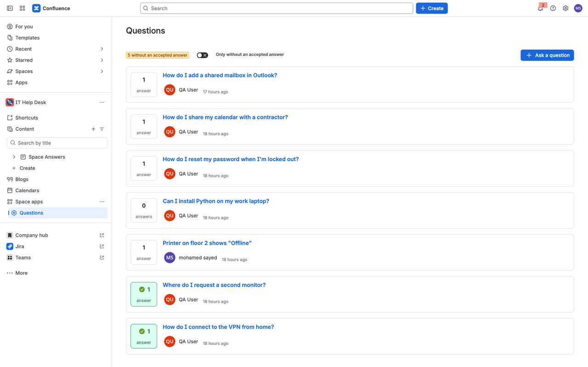
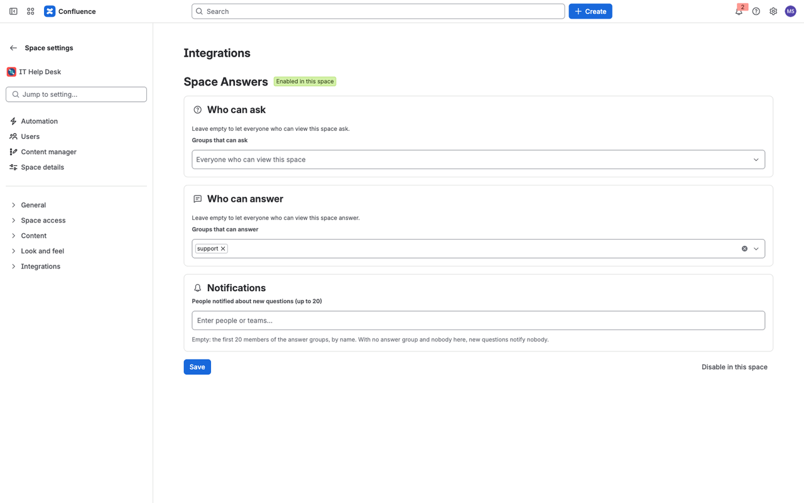
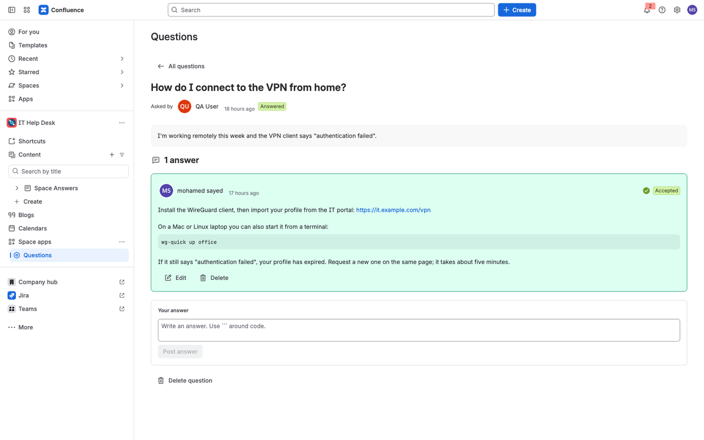
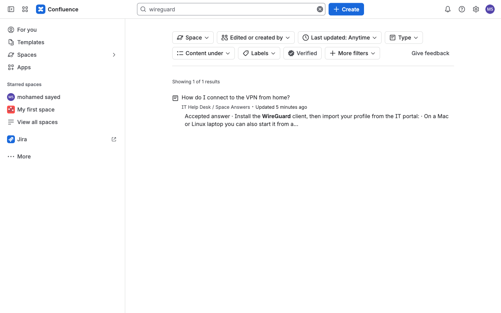

[Documentation](index.md) · [Support](support.md) · [Privacy policy](privacy.md) · [Terms](terms.md)

# Documentation

Questions and answers in each Confluence space. Every question has a Confluence page with all its answers, so Confluence search finds them.

Provided by Rabab Ismail Ahmed Kamel, Madrid, Spain. Support: see the [Support](support.md) page.

## Quick start

1. A site admin installs **Space Answers for Confluence** from the Atlassian Marketplace.
2. In a space, a space admin opens **Space settings → Integrations → Space Answers** and clicks **Enable in this space**.
3. On the same page, choose the groups that can ask and answer, and click **Save**.
4. Open **Questions** in the space sidebar and click **Ask a question**.



## 1. Install

A site admin installs the app from the Atlassian Marketplace. Until a space admin enables the app in a space, the Questions page of that space only says that the app is not enabled there.

## 2. Enable the app in a space

A space admin opens **Space settings → Integrations → Space Answers** and clicks **Enable in this space**.

Before enabling, check **Space settings → Space access → Permissions**:

- The **Space Answers** app user needs **Create** and **Delete** for *Question*, **Add**, **Delete** and **Restrict** for *Pages*, and **Add** for *Comments*. If any of them is missing, a space admin grants it by hand; enabling tells you exactly which one.
- People should have **View** only for *Question*. New spaces give "All licensed users" Create for every content type. While anyone other than admins and the app can create Question content directly, the app refuses to enable the space and names the group or user to change. This keeps every question and answer behind the app's checks.

When the space is enabled, the app creates a page called **Space Answers** in the space's page tree ("Space Answers (app)" if a page with that name already exists). Question pages sit under it. Only the app can edit these pages.



## 3. Choose who asks, who answers and who is notified

On the same settings page:

- **Who can ask** — the groups that may ask. Empty means everyone who can view the space.
- **Who can answer** — the groups that may answer. Empty means everyone who can view the space.
- **Notifications** — up to 20 people who are notified about new questions. If nobody is picked, the first 20 members of the answer groups (by name) are notified. With no answer group and nobody picked, new questions notify nobody, and the settings page says so.

Click **Save**.

## 4. Ask and answer

- Open **Questions** in the space sidebar and click **Ask a question**.
- Open a question to answer it. Answers keep links, and text between ``` marks is shown as a code block.
- The person who asked, or a space admin, clicks **Accept** on the answer that worked. The accepted answer is shown first.
- Authors edit or delete their own answers. Space admins can delete any answer or question.
- The toggle **Only without an accepted answer** shows what is still open.



## 5. Search

Use Confluence's normal search or quick search. Each question's page holds the question and all its answers, so a word that appears only in an answer is found. The page links to the question in the app.



## 6. Notifications

A new question mentions the people from step 3, and a new answer mentions the person who asked. Both arrive in the Confluence bell with a link to the question. The mentions are comments on the app's "Space Answers" page.

## 7. Light and dark theme

The app follows each person's Confluence theme.

## 8. Subscription

The app is paid through Atlassian with a free trial. Without an active subscription people can still read questions and answers, delete them and disable the app in a space; asking, answering, editing, accepting and changing settings are refused with a message until a site admin subscribes in Atlassian Administration, under Apps.

## 9. Disable or uninstall

**Disable in this space** on the settings page turns the Questions page off for that space; existing questions stay in Confluence. Uninstalling the app removes its settings; questions and their pages remain as Confluence content until a space admin deletes them.

## 10. Data

Questions and answers are stored as content in your Confluence site. Atlassian's Forge storage for your site holds the space settings and a small index per question (title, asker's account ID, date, answer count, accepted answer and the id of its page). Nothing is sent outside Atlassian. See the [Privacy policy](privacy.md).

## Not included

Moving questions over from Questions for Confluence, importing or exporting questions, merging duplicates, a macro for embedding questions in other pages, uploading images into questions and answers, voting, tags and reputation points, answer edit history, a view made for the Confluence mobile app, guest and anonymous users, and Data Center or Server.
